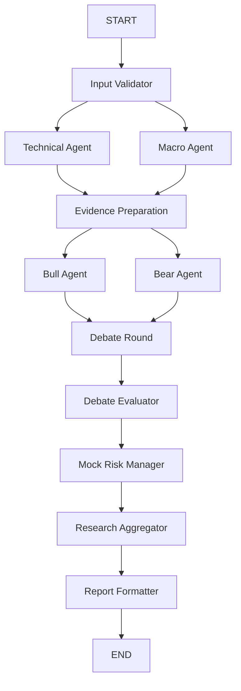

# STEP 13 — 규칙 기반 Mock Risk Manager

중단 시점에 있던 `config/risk_settings.py`, `risk/models.py`, `risk/metrics.py`,
`risk/position.py` 및 `backtest/risk.py`의 순수 슬리피지 함수를 이어서 사용한다.
새로운 시장 데이터 수집기나 백테스트 엔진을 만들지 않는다.
실제 LangGraph StateGraph에서 Risk Manager 노드를 실행하며, 판단은 결정론적 Python 규칙이다.
Risk Manager는 OpenAI/LLM 클라이언트를 호출하지 않는다.

## 실행과 기존 기능 호환성

Python 3.11, LangGraph 1.2.15, Pydantic 2.14.1, pandas 3.0.6,
NumPy 2.4.6, Streamlit 1.64.0 환경에서 구현했다. 새 패키지는 추가하지 않는다.

```powershell
.\.venv\Scripts\python.exe -m streamlit run app.py
.\.venv\Scripts\python.exe -m pytest -q
```

기본 Risk Manager 설정은 OFF다. 기존 단일 LLM, Mock/LLM Workflow,
전략 빌더, 백테스트, STEP 6 손절·익절·트레일링 및 Risk ON/OFF 비교를 유지한다.
이번 Risk Manager는 Mock Workflow에서만 켤 수 있다.
기존 LLM Workflow는 Risk Manager를 끄고 기존 비용 승인 정책으로 사용할 수 있다.
개발/자동 테스트 중 유료 API 호출은 하지 않는다.

| Debate | Risk Manager | 경로 |
| --- | --- | --- |
| OFF | OFF | 기존 STEP 11 그래프 |
| ON | OFF | 기존 STEP 12 Debate 그래프 |
| OFF | ON | Technical/Macro 합류 → Risk Manager → Aggregator → Formatter |
| ON | ON | Debate Evaluator → Risk Manager → Aggregator → Formatter |



ON 경로에서도 기존 병렬 분기와 list-form barrier edge를 유지한다.
Risk OFF에는 추가 노드/위험 결과가 없으며 기존 Aggregator/리포트 계약을 그대로 사용한다.
`backtest/engine.py`는 수정하지 않았다. `backtest/risk.py`에는 기존 엔진과 같은
불리한 슬리피지 공식을 담은 독립 함수를 추가했으며 기존 위험 판정은 바꾸지 않았다.

## 정량 지표

입력은 선택 분석 구간의 실제 확정 OHLCV이며 원본 DataFrame을 변경하지 않는다.
유한한 양수 OHLC, 가격 범위, 음수가 아닌 거래량, 중복 없는 시간순 타임스탬프를 검증한다.
시각은 UTC로 정규화하고 `봉 시작 + timeframe <= 요청 시각`을 검사한다.
가격/수량을 임의로 보충하거나 미래 행을 사용하지 않는다.
모든 결과에 실제 관측 구간, 봉 수, 수익률 수, 기대 간격, 실제 간격을 기록한다.

- 봉 수익률: `r[t] = close[t] / close[t-1] - 1`.
  시간 간격이 정확히 한 봉인 경우만 사용하고, 누락 구간을 가로지르는 수익률은 제외한다.
- 봉 변동성(%): `std(r, ddof=1) × 100`. 유효 수익률 두 개 미만이면 N/A다.
- 연율 변동성(%): `봉 변동성 × sqrt(365 × 86400 / 봉 간격(초))`.
  암호화폐 365일·24시간 거래와 제곱근 시간 가정이며 미래 변동성 예측값이 아니다.
- 종가 MDD(%): `max(1 - close[t] / cummax(close)[t]) × 100`.
  조회 구간 종가만 사용한다. 봉 내부 낙폭이나 전체 투자기간 낙폭으로 해석하지 않는다.
  최대 낙폭의 고점/저점 시각은 해당 봉의 종료 시각이며 낙폭이 0이면 시각은 N/A다.
- TR: `max(high-low, abs(high-prev_close), abs(low-prev_close))`.
  각 연속 구간의 첫 TR은 `high-low`다. ATR(14)은 첫 14개 TR 평균으로 초기화하고,
  이후 `ATR[t]=(13×ATR[t-1]+TR[t])/14`인 Wilder 평활을 사용한다.
  누락 봉 뒤에는 다시 초기화하며 연속 14봉 미만은 N/A다.
- ATR 비율(%): `ATR(14)/마지막 확정 종가×100`.
- 변동성 확대: 최근 20개 연속 수익률 표준편차 / 그 직전 20개 표준편차.
  직전 값이 0이면 비율은 N/A이며 최근 변동성이 양수이면 확대 경고를 기록한다.
- 거래량 급증: 현재 확정 거래량 / **현재 봉을 제외한 직전 20봉** 평균.
  평균이 0이면 나누지 않고 데이터 품질 문제로 표시한다.

정렬/중복/미확정·미래 봉/비수치 값 같은 필수 입력 오류는 명시적 검증 실패로 처리한다.
오류 입력으로 정상 위험 등급을 생성하지 않는다.
표본 부족, 내부 누락, 일부 수집 표시, 핵심 지표 부족, 필수 분석 노드 실패는 UNKNOWN이다.
정상 계산된 0과 계산 불가능한 N/A를 구분한다.

## 등급과 연구 상태

기준은 `config/risk_settings.py` 및 `RiskThresholds`로 분리했다.
다음 값은 연구용 초기 가정이며 검증된 최적 투자 기준이 아니다.
유효 수익률 최소 40개와 모든 필수 지표를 요구한다.

| 지표 | LOW | MODERATE | HIGH | CRITICAL |
| --- | --- | --- | --- | --- |
| 연율 변동성(%) | <40 | 40 이상 | 80 이상 | 150 이상 |
| 종가 MDD(%) | <10 | 10 이상 | 25 이상 | 40 이상 |
| ATR/종가(%) | <2 | 2 이상 | 5 이상 | 10 이상 |

각 지표의 가장 높은 위험 단계를 사용한다. 주장 수나 시장 방향으로 등급을 정하지 않는다.
변동성 확대 1.5배 이상은 최소 HIGH, 거래량 3배 이상은 최소 MODERATE다.
각 적용 값과 경계값, 품질 문제를 `grade_basis`에 기록한다.
오래된 구간도 과거 연구로 계산할 수 있으나 두 봉 이상 지연된 자료에는 과거 자료 경고와 HOLD를 적용한다.

`trading_action`은 실제 주문이 아닌 내부 연구 상태다.

- **ABSTAIN**: UNKNOWN/CRITICAL, 유효 포지션 계산 불가, 허용 수량 0 또는 위험 노드 실패.
- **HOLD**: 전체 명목 노출의 손실 한도 초과, HIGH, 오래된 자료 또는 미해결 토론 상충.
- **REVIEW**: 위 보류 사유가 없는 경우의 추가 연구 검토 상태.

위험 등급은 상승/하락과 별개다. Aggregator는 기존 시장 방향을 보존하면서
별도 `research_action`, 위험 한도, 위험 요인/차이를 최종 리포트에 전달한다.
위험 한도 초과나 필수 검증 실패를 REVIEW로 완화하지 않는다.
HIGH/CRITICAL 자체는 계산 실패가 아니다. 등급 평가와 실행 성공 여부를 구분한다.

## 가상 포지션 계산

이는 현재 종가를 기준으로 한 정적 양방향 손절 시나리오다.
기존 백테스트의 **실제 가상 진입 체결가 기준 손절**과 구분하며 백테스트 거래/성과를 바꾸지 않는다.
변수는 원금 `C`, 손실 허용 비율 `a`, 기준 종가 `P`, 손절 거리 `d`, 레버리지 `L`,
편도 수수료 `f`, 편도 슬리피지 `s`다.

| 가정 | LONG | SHORT |
| --- | --- | --- |
| 진입 체결가 `E` | `P(1+s)` | `P(1-s)` |
| 원시 손절 기준가 `S` | `P(1-d)` | `P(1+d)` |
| 청산 체결가 `X` | `S(1-s)` | `S(1+s)` |
| 단위 수량 손실 `loss` | `E-X+f(E+X)` | `X-E+f(E+X)` |

왕복 수수료는 `q×f(E+X)`, 슬리피지 비용은 `q×(abs(E-P)+abs(X-S))`다.
슬리피지는 체결 손실에 이미 반영되어 있으므로 손실에 다시 더하지 않는다.
비용 항목은 이 반영분을 분리해서 설명하는 값이다.

허용 손실 `B=C×a`, 최악의 단위 손실 `w=max(loss_LONG, loss_SHORT)`에 대해:

```text
비용 제외 참고 수량 = B/(P×d)
비용·증거금 제한 수량 q = min(B/w, C/max(E_LONG/L+f×E_LONG, E_SHORT/L+f×E_SHORT))
기준 명목 가치 = q×P
진입 명목 가치 = q×E
필요 증거금 = q×E/L
제한 규모 최대 예상 손실 = max(q×loss_LONG, q×loss_SHORT)
전체 노출 가정 = C×L, 전체 노출 예상 손실 = (C×L/P)×w
```

두 방향에 공통으로 제한 수량을 적용한다. 레버리지로 손실 예산을 늘리지 않는다.
양쪽의 `증거금+진입 수수료 <= C`, `예상 손실 <= B`를 검사한다.
허용 비율 0이면 수량 0과 ABSTAIN이다. 유한하지 않거나 수학적으로 불가능한 입력은 오류다.

최상위 `risk_limit_exceeded`는 **원금×레버리지 전체 노출 가정**의 초과 여부다.
실제로 입력한 주문이 있다는 의미가 아니다. 별도로 계산한 비용 포함 제한 규모의
`adjusted_limit_exceeded`와 구분해 UI에 함께 표시한다.
`estimated_loss`/`estimated_cost`는 제한 규모의 양방향 최댓값이다.
설정만으로 전체 노출을 승인하거나 해당 제한 규모의 실제 체결을 보장하지 않는다.

실제 손절 체결, 거래량 제한/부분 체결, 호가, 최소 주문 단위, 유지증거금,
펀딩/차입비 및 강제청산 가격을 이 정적 시뮬레이션에 추정해 넣지 않는다.
실제 시장의 갭/유동성 부족에서는 예상보다 큰 손실이 가능하다.
STEP 5~6 백테스트의 기존 거래량 제한/부분 체결 정책은 그대로 유지한다.

## State, 검증, 로그

`RiskState`는 기존 DebateState를 확장한다. 원본 DataFrame은 기존 Runtime Context의 참조를 재사용하고,
상태에는 작은 정량 요약/설정/근거만 저장한다.
추가 필드는 `risk_manager_enabled`, `risk_input`, `risk_result`, `research_action`,
`pre_risk_signal`, `risk_manager_status`다.
기존 append reducer의 노드 로그와 오류 필드를 그대로 사용한다.

에이전트 실행 전 Technical/Macro 결과와 기준 시각/종가를 재검증하고,
Debate가 있으면 Evaluator를 재계산하여 검증된 주장 ID/상충 근거만 받는다.
Risk 근거에는 출처, ID, 수치, 단위, 관측 시각을 저장한다.
설정값의 시각은 시나리오 적용 기준 시각이며 과거 경제지표 발표 시각이 아니다.
Pydantic 스키마 검증 외에 원본 입력으로 정량/포지션/등급/행동을 재계산해
전체 결과를 대조한다. 없는 ID/변경된 값·단위·시각·행동은 보정하지 않고 거부한다.

Macro는 자료가 없으면 INSUFFICIENT_DATA, 유효 관측값이 있으면 CONTEXT_ONLY다.
관측일을 발표일로 사용하거나 임의 빈티지를 채우지 않는다.
FRED 현재 개정값과 STEP 8 사후 상관관계를 과거 거래 방향/백테스트에 전달하지 않는다.
선택적 Macro 자료 부족과 Macro 실행 실패를 구분하며 전자는 Technical 결과를 삭제하지 않는다.

노드 기록은 WAITING/RUNNING/COMPLETED/FAILED/SKIPPED와 UTC 시작/종료/소요 시간이다.
Risk 실패 시 검증된 기존 분석을 유지하고 가능하면 PARTIAL+ABSTAIN으로 보고한다.
Technical 필수 입력 실패처럼 전체 결과를 구성할 수 없으면 FAILED다.
UNKNOWN 등급도 전체 보고서는 PARTIAL+ABSTAIN이다.
Risk 노드 오류가 이미 완료된 Debate 평가를 소급 변경하지 않도록 토론 재검증에서 후속 노드 오류를 분리한다.
실행 로그에는 예외 원문, API 키, 헤더, 원본 DataFrame을 넣지 않는다.
UI 상태/시간은 실행 후 기록이며 실시간 진행 화면처럼 표현하지 않는다.

시장·봉·기간·자료·Macro 선택·Debate·Risk 설정이 바뀌면 기존 결과를 무효화한다.
표시용 지표 체크박스는 결과나 시장 데이터 캐시를 불필요하게 다시 계산/조회하지 않는다.
Debate 중복 차단 키에도 Risk 설정을 포함해 다른 시나리오를 같은 실행으로 오인하지 않는다.

## 자동 검증과 한계

`tests/test_risk_manager.py`는 손계산 가능한 수익률/ATR/MDD/비용/레버리지,
등급 경계, 누락/UNKNOWN, UTC/미래 데이터, 근거 변조, 노드 실패,
실제 StateGraph 네 조합, 재현성과 원본 불변성을 확인한다.
`tests/test_risk_manager_ui.py`는 실제 AppTest 버튼/설정/무효화/캐시/로그,
기존 단일 Mock 분석과 백테스트 설정 보존, 유료 호출 차단을 확인한다.
OpenAI SDK와 네트워크 전송을 감시하는 모의 테스트로 Mock 무호출을 검증한다.
전체 pytest는 STEP 1~12 회귀 테스트와 STEP 5 고정 결과 10개 비교도 포함한다.
옵션으로 실행하는 기존 외부 API 테스트의 skip은 실 API 검증 성공으로 보고하지 않는다.

### 2026-10-17 검증 결과

- STEP 13 전용: 53 passed, 38 subtests passed.
- 전체: 471 passed, 14 skipped, 417 subtests passed (131.96초).
  기존 STEP 1~12의 418개 테스트와 STEP 5 고정 결과 10개 비교를 포함한다.
  14 skip은 기존 명시적 활성화 방식의 Binance/FRED/Crypto×Macro 실 API 테스트다.
- Python 3.11.9에서 120개 Python 파일 문법, Risk/graph/UI 모듈 import,
  `pip check`, `git diff --check`를 통과했다.
- 별도 서버 `http://127.0.0.1:8506`의 HTTP/health 200 및 WebSocket 버튼 실행을 확인했다.
  실제 Binance BTC/USDT·ETH/USDT 각각 2,207개 확정 봉(마감 2026-10-17 12:00 UTC)으로
  실제 StateGraph의 Mock Debate + Risk Manager가 실행됐다.
  BTC LOW/HOLD, ETH MODERATE/HOLD가 표시됐고 데이터 품질 오류/렌더링 예외는 없었다.
  이 값은 당시 자료·기본 연구 설정에 대한 결과이며 고정된 투자 판단이 아니다.
- 최초 샌드박스 서버는 소켓 접근 거부로 Binance 조회에 실패했다.
  네트워크 접근이 허용된 서버 실행 환경에서 재검증했으며 데이터 수집 코드는 변경하지 않았다.
- OpenAI 유료 호출은 하지 않았다. FRED 신규 실 API 호출은 하지 않았고 재사용/시점 제약은 모의 응답으로 검증했다.

등급 임계값은 자산/봉마다 검증된 기준이 아니며 연율화/구간 길이에 민감하다.
과거 자료 평가이며 수익·승률·투자 성공·손절 체결을 보장하지 않는다.
임의 가격, 발표일, 빈티지, 강제청산 가격, 최적 레버리지는 생성하지 않는다.

공식 계산/실행 참고:
[NumPy std와 ddof](https://numpy.org/doc/stable/reference/generated/numpy.std.html),
[Fidelity ATR 설명](https://www.fidelity.com/learning-center/trading-investing/technical-analysis/technical-indicator-guide/atr),
[LangGraph Graph API](https://docs.langchain.com/oss/python/langgraph/graph-api).
