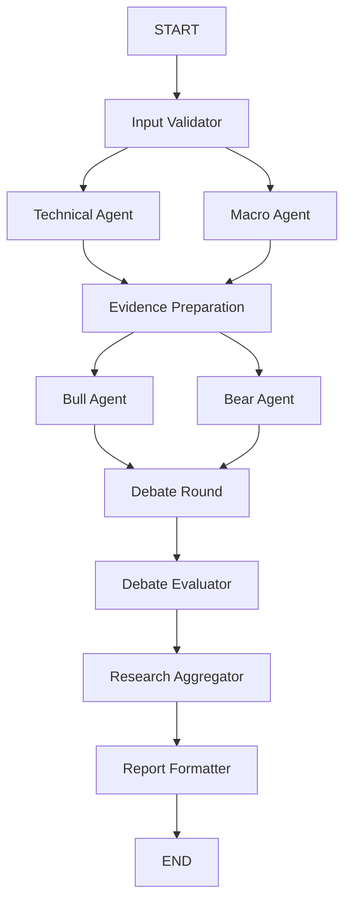

# STEP 12 — 실제 LangGraph / 결정론적 Mock Bull·Bear Debate

## 실행 범위

이번 구현은 **실제 LangGraph StateGraph가 실행하는 Mock 규칙 기반 토론**이다.
Bull/Bear의 주장과 반박은 입력에 따라 생성되고 다음 노드의 입력으로 전달된다.
미리 작성한 시장 토론을 UI에 재생하거나 실제 LLM 협업으로 표시하지 않는다.
OpenAI 호출, 주문, 자동매매, AI Risk Manager, 전략/백테스트 변경은 추가하지 않았다.

기존 STEP 11 Mock/LLM Workflow와 STEP 9 단일 분석은 유지된다.
Debate는 기본적으로 꺼져 있고, 켜면 **Mock Workflow에서만** 실행할 수 있다.
LLM Workflow와 Debate를 함께 선택하면 실행 버튼을 비활성화하며 서버 측에서도 차단한다.
기존 LLM 분석은 Debate를 끄고 별도의 비용 승인 뒤 실행한다.
토론 실행으로 유료 경로가 자동 활성화되지 않는다.

## 그래프 구조



실제 그래프에는 입력 실패/취소/중복 시 END로 가는 경로와, 핵심 기술 자료가 부족할 때
Bull/Bear를 건너뛰고 Evaluator로 가는 경로도 있다.
`add_edge(["technical_agent", "macro_agent"], "evidence_preparation")`와
`add_edge(["bull_agent", "bear_agent"], "debate_round")`가 각 분기의 완료를 기다린다.
최대 동시성 2이며 반복 edge가 없는 DAG다. recursion limit 12를 유지한다.
사용 API는 `StateGraph`, `START`, `END`, `compile()`, `stream(stream_mode="values")`다.
[공식 LangGraph Graph API](https://docs.langchain.com/oss/python/langgraph/graph-api)를 따른다.

노드의 입력 타입은 `DebateState`를 명시한다. 기존 `WorkflowState`만 지정하면 LangGraph가
추가 토론 필드를 입력 채널에서 제외하므로 확장된 입력 스키마를 사용한다.

## 역할과 라운드

기존 Technical/Macro 결과를 원본 근거와 다시 검증해 공용 `DebateEvidence`를 만든다.
근거에는 ID·출처·수치·단위·관측 시각·문장·방향 역할이 보존된다.
Macro의 관측 수준은 문맥으로만 전달하며, Bull/Bear 방향 주장과 반박의 수치 근거는
검증된 TECHNICAL 자료로만 제한한다. FRED 관측일을 발표일로 간주하지 않는다.

### Round 1

- Bull은 `role=bullish`, Bear는 `role=bearish`인 실제 입력 근거마다 제한적인 관측 주장을 만든다.
- 반대 방향 관측은 `counterarguments`에 인정하고 데이터 한계는 `uncertainties`에 포함한다.
- 자신의 방향 근거가 없으면 CLAIM을 만들지 않고 `INSUFFICIENT_EVIDENCE` 안내만 생성한다.
- 핵심 기술 데이터 자체가 부족하면 양측 주장을 만들지 않고 토론을 SKIPPED 처리한다.

### Round 2

각 어댑터의 `respond(evidence, opponent)`에 **실제 상대의 검증된 Round 1 결과**를 전달한다.
두 응답은 같은 Round 1 스냅샷을 기준으로 만들며 앞서 생성한 반박을 다른 쪽의 과거 입력에 섞지 않는다.

- 상대 CLAIM의 ID와 수치 근거를 직접 참조한다.
- 반대 방향 관측이 있으면 그 근거도 함께 인용해 방향 확정의 한계를 `REBUTTAL`로 설명한다.
- 반박 근거가 없으면 상대 관측을 인정하는 `CONCESSION`을 만든다.
- 상대 CLAIM이 없으면 반박할 대상이 없다는 `INSUFFICIENT_EVIDENCE`를 만든다.
- 상대/자신의 노드가 실패한 경우 없는 주장을 만들어 반박하지 않는다.

반박은 상대의 관측 수치를 거짓으로 판정하는 것이 아니다. 서로 다른 지표가 동시에 참일 수 있으며
시장 방향에 대한 과도한 해석을 제한한다. 최초 주장을 복사해 반박으로 표시하지 않는다.

`config/settings.py`의 기본 라운드는 2, 지원 값은 `(1, 2)`다.
1라운드는 최초 주장만 기록하고 Debate Round를 SKIPPED 처리한다. 2라운드는 상호 검토까지 실행한다.
추가 라운드/무한 루프는 지원하지 않으며, bool·문자열·범위 밖 값도 서버에서 거부한다.

## 스키마와 검증

`DebateMessage`에는 round, speaker, claim_id, target_claim_id, evidence_ids, citations,
message_type, content, validation_status가 있다. ID는 실행 내에서 안정적인 해시 ID이며,
동일한 입력과 라운드는 같은 공개 토론 내용을 만든다. UUID·실제 실행 시각/처리 시간은 달라진다.

Pydantic 스키마 검사와 내용 검증을 분리한다. 생성 직후, Evaluator, Aggregator에서 재검증한다.

- 허용 ID와 원본 출처·수치·단위·관측 시각 일치
- 확정 기술 자료의 기준 시각, 미래 관측/미확정 자료 차단
- Macro 방향 인용 금지 및 관측일/발표일/빈티지 구분
- 상대 주장 ID와 인용 근거의 실제 대응
- 중복·누락 주장, 방향 변조, 원본에 없는 문장/사실 거부
- 준비된 근거 fingerprint의 변경 여부
- 원본 DataFrame 불변성 및 어댑터에 전달하는 작은 요약의 격리

Mock 내용은 검증 가능한 한국어 문장 계약을 따르므로 자유로운 사실 생성이 없다.
이는 환각 제거 또는 금융적 판단/예측 정확도 향상의 입증이 아니다.
향후 LLM 어댑터는 `PositionAgent`의 propose/respond 인터페이스를 구현할 수 있으나,
자유 서술을 허용하려면 그에 맞는 별도 내용 검증 정책도 필요하다.

## Debate Evaluator와 Aggregator

Evaluator는 유효 Bull/Bear CLAIM, 거부된 분기/반박, 검증된 메시지 ID,
반박/인정에서 참조한 상대 주장 ID, 미해결 상충, 부족 자료, 요약과 상태를 반환한다.
스키마/근거 검증에 실패한 생성 결과는 기록에 정상 메시지로 추가하지 않는다.
거부된 결과는 원문 대신 안전한 분기명·정적 사유로 기록하며 임의의 주장 ID를 만들어 보완하지 않는다.

`addressed_claim_ids`는 응답 대상이라는 의미이며 상대 관측의 사실성이 기각됐다는 뜻이 아니다.
양방향 지표가 공존하면 미해결 쟁점으로 기록하고, 주장 수/다수결/가중 점수로 승자를 정하지 않는다.
Aggregator는 기존 Technical/Macro 근거를 유지하며 검증된 토론 평가만 통합한다.
정상 토론이 기존 분석보다 강한 방향을 임의로 만들어 내지 않는다.
Debate OFF는 STEP 11의 기존 Aggregator/리포트와 동일한 분석 결과를 유지한다.

| 상황 | 토론 상태 | 전체 실행/리포트 |
| --- | --- | --- |
| 정상 주장/검토 | COMPLETED | 기존 원본 분석 상태 유지 |
| Macro 미선택/미조회 | 정상 토론 가능, 부족 자료 명시 | Technical 결과 유지 |
| 핵심 기술 데이터 부족 | SKIPPED, 평가 INSUFFICIENT_DATA | INSUFFICIENT_DATA 의견 |
| Macro 입력/실행 실패 | PARTIAL | PARTIAL |
| 한쪽 주장/반박 실패 | PARTIAL | 검증된 부분과 원본 분석만 PARTIAL |
| 양쪽 주장 실패 | FAILED | 원본 기술 분석이 정상이면 제한적 PARTIAL |
| Technical 또는 집계 실패 | FAILED | 전체 FAILED, 정상 최종 보고서 없음 |
| 취소 | CANCELLED | 전체 FAILED, 완료 보고서 없음, 검증된 부분 기록 유지 |
| 중복 | FAILED / DUPLICATE_REQUEST | 새 토론 없음, UI는 이전 결과와 당시 상태 유지 |

부분/실패 토론은 전체 성공으로 표시하지 않는다. 부분 토론의 방향은 기존 의견이
INSUFFICIENT_DATA이면 유지하고, 나머지는 보수적으로 NEUTRAL로 제한한다.

## State, 로그, 취소와 중복

`DebateState`는 기존 WorkflowState를 확장한다.
`debate_evidence`, fingerprint, `bull_result`, `bear_result`, `debate_round`, `debate_rounds`,
`debate_history`, `debate_evaluation`, `debate_status`를 추가한다.
병렬 분기는 자기 결과만 갱신하고 history/errors/node_execution_logs는 append reducer로 합친다.
실행 후 history를 round/speaker/claim_id로 정렬해 재현 가능한 표시 순서를 유지한다.
`execution_logs`는 기존 node_execution_logs의 최종 조회용 별칭이며 병렬로 중복 기록하지 않는다.

실행 ID, UTC 시작/종료, 소요 ms, WAITING/RUNNING/COMPLETED/FAILED/SKIPPED를 기록한다.
오류 원문·키·인증 헤더·비공개 내부 추론은 저장하지 않는다. 원격 LangSmith 추적을 끈다.

기존 UsageLedger의 lock/recent를 Mock 중복 방지에만 재사용한다.
같은 검증 입력/근거/라운드는 60초 중복 차단하며 유료 요청 기록·비용은 증가시키지 않는다.
UI는 중복 시 기존 실행 결과를 유지하고 차단된 새 시도 로그를 별도로 표시한다.

엔진은 선택적인 `threading.Event`의 협력적 취소를 노드 경계와 두 반박 사이에서 확인한다.
이미 검증한 부분 메시지는 보존한다. 현재 Streamlit은 빠른 동기 실행/실행 후 로그 방식이며
실행 중 취소 버튼이나 실시간 진행 상태 UI는 제공하지 않는다. Streamlit 자체의 중단 기능을
이 Event와 연결한 것으로 주장하지 않는다.

## UI 및 실행

- 기존 Multi-Agent 영역의 Debate 활성화 체크박스와 1~2라운드 선택
- 선택한 실제 그래프의 로컬 Mermaid 다이어그램
- Bull/Bear 실제 노드 상태 카드, Risk Manager는 NOT CONNECTED 유지
- 라운드별 Bull/Bear 컬럼, 공개 주장/반박/인정, 근거 ID·원본 수치/단위/시각
- Evaluator 결과, 미해결 쟁점, 자료 부족, 한국어 최종 보고서
- 모든 노드의 실제 처리 시간/오류 및 실행 후 로그
- 입력·종목·봉·기간·선택 Macro·모드·Debate·라운드 변경 시 결과 무효화
- 표시 지표 토글만 바뀌면 결과/기존 데이터 캐시 재사용

새로운 데이터 수집/백테스트 로직이나 패키지 의존성은 추가하지 않았다.
검증 환경은 Python 3.11, LangGraph 1.2.15, Pydantic 2.14.1, Streamlit 1.64.0이다.

```powershell
.\.venv\Scripts\python.exe -m streamlit run app.py --server.port 8505
.\.venv\Scripts\python.exe -m pytest -q
```

기본 Mock Debate에는 OpenAI/FRED 키가 필요 없다. 이미 수집된 실제 시장 자료가 필요하며,
시세 조회 실패를 임의 가격으로 대체하지 않는다. 단위 테스트에서는 합성 입력임을 명시한다.

## 자동 검증 결과

STEP 12 신규 테스트 **45개** 통과.
STEP 1~11 회귀 테스트를 포함한 전체 결과: **418 passed, 14 skipped, 379 subtests passed** (134.24초).
14개는 기존 선택적 외부 실 API 테스트로 이번 실행에서 활성화하지 않았다.
StateGraph 컴파일/병렬 합류, 상호 참조, 1~2라운드, 근거/시각 오류,
데이터 부족/부분 실패, 취소/중복, 원본 불변성, 재현성, Mock API 미호출,
기존 STEP 11 OFF 결과 동일성, UI 버튼/캐시/상태/무효화를 검증했다.
실제 유료 OpenAI API 호출은 수행하지 않았다.

Python 소스 108개 문법 검사, 별도 프로세스 전체 로컬 모듈 import 테스트,
`pip check`, `git diff --check`도 통과했다.
실제 서버 `http://127.0.0.1:8505`에서 HTTP 200/health ok를 확인했다.
WebSocket으로 실제 Binance 시장 차트 렌더링, Debate 활성화만으로 실행되지 않는 동작,
실행 버튼 이후 Mock Debate COMPLETED와 검증된 Round 2 메시지 6개 표시까지 확인했다.
서버 점검 클라이언트의 최초 selectbox 전송 형식 오류는 현재 Streamlit의 문자열 직렬화 형식으로
점검 클라이언트를 수정해 해결했다. 이 문제로 앱 코드를 변경하지 않았다.
OpenAI 실 API 호출은 없으며 기존 LLM 경로의 회귀 검증은 모의 HTTP 응답으로만 수행했다.

현재 자료는 발표 시각·당시 빈티지가 검증된 역사적 Macro 입력이 아니며,
실제 LLM Debate·AI Risk Manager·실거래·투자 성능 검증은 이번 범위에 포함하지 않는다.
