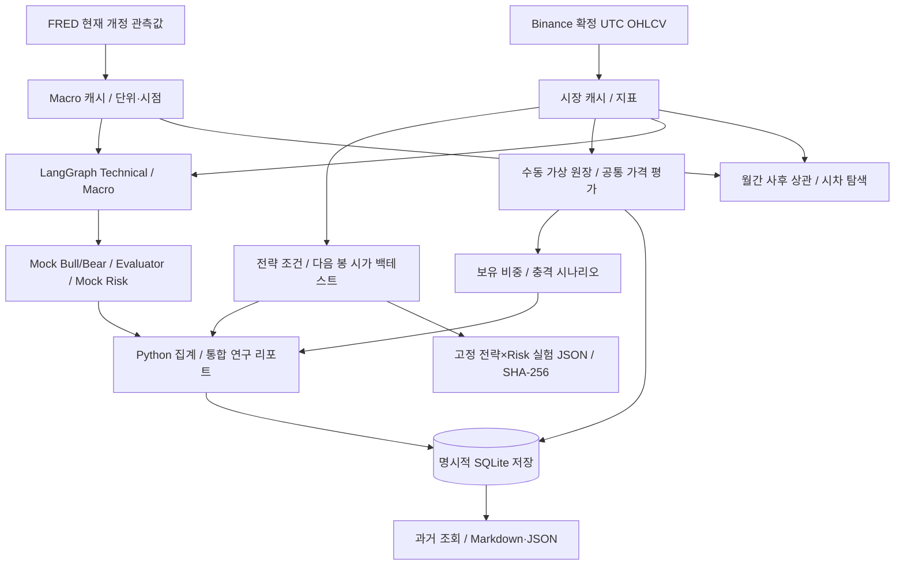

# SIGFIN 최종 요구 추적·검수

기준: **2026-11-12 (Asia/Seoul)**, STEP 19 커밋 `7060ebd`. STEP 20 결과는 [개발일지](steps/STEP_20.md)에 기록한다. 아래 테스트 파일은 검증 범위의 근거이며 개별 테스트의 존재만으로 실 API나 수동 통과를 뜻하지 않는다.

## 요구 → 구현 → 검증 근거

| 단계/요구 | 실제 코드 | 자동 검증·계약 | 판정/경계 |
| --- | --- | --- | --- |
| 1 대시보드 | [app.py](../app.py), [ui](../ui) | [app 시험](../tests/test_app.py), [STEP 01](steps/STEP_01.md) | 화면/선택/캐시 회귀. 전체 리디자인 제외 |
| 2 확정 시장 자료 | [Binance](../collectors/binance.py), [캐시](../services/market_data.py) | [수집 시험](../tests/test_binance.py), [연결 오류](../tests/test_connection_errors.py) | UTC·페이지/한도·실패 분리. 이번 실 API 미실행 |
| 3 지표 | [technical](../indicators/technical.py) | [수치/초기화 시험](../tests/test_indicators.py), [계약](technical_indicators.md) | Wilder/EMA 초기화·NaN·미래 자료 미사용 |
| 4 전략 | [models/evaluator](../strategies/evaluator.py), [빌더](../ui/strategy_builder.py) | [평가](../tests/test_strategies.py), [저장](../tests/test_strategy_storage.py) | 명시 연산·교차/충돌·JSON 검증 |
| 5 백테스트 | [engine](../backtest/engine.py), [metrics](../backtest/metrics.py) | [손계산/전이 시험](../tests/test_backtest.py), [계약](backtesting.md) | next-open·비용/원장·실현/미실현. 실제 체결 아님 |
| 6 위험 체결 | [risk](../backtest/risk.py) | [위험 시험](../tests/test_risk.py), [체결 규칙](risk_management.md) | 갭/동시 손익절/직전 극값·부분 체결·Risk OFF 기준 유지 |
| 7 FRED | [수집](../collectors/fred.py), [서비스](../services/macro_service.py) | [단위/응답](../tests/test_fred.py), [기간 경계](../tests/test_fred_boundaries.py) | 관측일≠발표일, 개정/빈티지 미추정. 이번 실 API 미실행 |
| 8 월간 탐색 | [analytics](../analytics), [통합](../services/crypto_macro_service.py) | [상관/시차](../tests/test_crypto_macro.py), [계약](crypto_macro_analysis.md) | 공통 월/표본·시차 방향. 시점 준수 분석은 자료 없으면 금지 |
| 9 단일 AI | [client](../llm/client.py), [validators](../llm/validators.py) | [응답/오류](../tests/test_ai_client.py), [UI](../tests/test_ai_ui.py) | Mock/모의 HTTP 검증. 실계정 OpenAI 미검증 |
| 10~11 역할 그래프 | [workflow](../graph/workflow.py), [LLM adapters](../agents/llm_agents.py) | [그래프](../tests/test_workflow.py), [LLM 모의 시험](../tests/test_llm_workflow.py) | 실제 StateGraph/병렬 합류. 선택 Live 비용/승인·오류는 모의 시험 |
| 12 Debate | [debate_workflow](../graph/debate_workflow.py), [검증](../graph/debate_validation.py) | [토론 시험](../tests/test_debate.py) | 실제 그래프에 Mock 주장/반박. 유료 LLM Debate 없음 |
| 13 Risk Manager | [risk manager](../agents/risk_manager.py), [risk](../risk) | [시험](../tests/test_risk_manager.py), [계약](ai_risk_manager.md) | Mock 정량 등급/노출·UNKNOWN·HOLD/REVIEW/ABSTAIN. 주문 아님 |
| 14 수동 원장 | [portfolio engine](../portfolio/engine.py), [UI](../ui/portfolio_view.py) | [손계산](../tests/test_portfolio.py), [UI](../tests/test_portfolio_ui.py) | 현금·평균가·비용·보유량·평가. 무레버리지 |
| 15 저장 | [LocalStore](../services/local_store.py), [snapshots](../services/research_snapshots.py) | [저장 시험](../tests/test_local_store.py), [통합 백업/새 연결](../tests/test_system_integration.py) | 임시 DB 검증. 사용자 원본 백업/교체는 미실행 |
| 16 보유 위험 | [서비스](../services/portfolio_risk_service.py), [UI](../ui/portfolio_risk_view.py) | [시나리오](../tests/test_portfolio_risk.py), [공통 가격/UI](../tests/test_portfolio_risk_ui.py) | 공통 시각 재검증·비용 포함. 실제 평가 이력 부족은 N/A |
| 17 통합 보고 | [research](../services/research_service.py), [UI](../ui/research_view.py) | [보고서](../tests/test_research_report.py), [저장/무효화/UI](../tests/test_research_ui.py) | 근거·수집 시각 재조회·저장/복원/개발자 JSON 회귀. 외부 검수 이월 |
| 18 고정 비교 | [experiments](../backtest/experiments.py), [해시](../backtest/experiment_verification.py) | [실험](../tests/test_experiments.py), [기준 대조](../tests/test_experiment_verification.py), [UI](../tests/test_experiment_ui.py) | 12조합·SL 1%·원장·JSON 반복·해시. 과거 사용자 실 BTC 수동 확인은 STEP 18 기록 |
| 19 통합 안정화 | [통합 회귀](../tests/test_system_integration.py), [UI 회귀](../tests/test_system_ui.py) | [STEP 19](steps/STEP_19.md), [운영](local_operation.md) | 스키마 선검사·깊은 JSON·8MB 결과·동시성·별도 환경 |
| 20 문서/시연 | [README](../README.md), [오프라인 진입점](../demo/offline.py) | [신규 시연 시험](../tests/test_offline_demo.py), [시연 순서](demo_scenario.md) | 일반 앱 보존·합성/실자료 구분·시험 DB·통신 차단 |

## STEP 20 작업별 수용 기준

| ID | 산출물/검수 | 상태 판단 근거 |
| --- | --- | --- |
| SF-20-01 | 이 추적 표·실제 코드/시험/과거 기록·미검증 이월 | 1~19를 재구현하지 않고 요구/근거 대조. 과거 과정/날짜를 생성하지 않음 |
| SF-20-02 | 루트 README·설치/화면/단위·모드/저장/한계 | Windows3.11 lock/import/pip check/서버 확인은 STEP 20 실행 기록 참조. APP_NAME/버전은 해시 호환성 때문에 유지 |
| SF-20-03 | 13분 권장 흐름·아키텍처·실험/보고서·실패 경로 | 별도 오프라인 진입점, 합성/부족/오류 시연. 실제 발표 리허설 완료를 뜻하지 않음 |
| SF-20-04 | 전체 pytest·대표 UI·내보내기/저장/백업/복원·해시 보존·이월 | 실행 결과는 STEP 20에 명시. 자동/격리 브라우저/사용자 확인을 구분하고 원본 DB 미변경 |

## 아키텍처와 시점 경계

Macro 관측일을 공개 시각으로 forward-fill하거나 과거 주문 근거에 넣는 경로는 허용하지 않는다. 백테스트/포트폴리오 계산은 LLM의 자유 생성 숫자로 바꾸지 않는다. 원장 기록·AI/백테스트 실행·저장·복원은 각각의 명시적 버튼이고 표시 변경은 주문/과금이 아니다.

## 최종 사용자 확인/미검증 이월

- STEP 18 사용자가 실제 BTC 12회 비교/JSON·SHA-256·1% 손절/STOP_LOSS를 확인한 기록을 보존한다. STEP 19 사용자의 ‘주요 기능 정상’ 보고는 개별 미관측 항목의 수동 통과로 확장하지 않는다.
- 이번 자동·합성 브라우저 검수의 실제 범위는 [STEP 20](steps/STEP_20.md)만을 따른다. 개인 발표 장비에서 10~15분 리허설, 제출 형식과 화면 읽기/다운로드 위치는 사용자가 재확인한다.
- `SF-17-06`: 실계정 유료 LLM의 실제 응답·사용량/청구·Live 저장/복원. 사전 비용 승인 없이 실행하지 않는다.
- `SF-17-07`: 실제 Binance/FRED 통합 리포트 값·단위·근거/시각/실패 대조. 외부 opt-in 시험 14개도 미실행으로 구분한다.
- `SF-POST-01`: STEP 20 이후 별도 범위의 전면 UI/UX 리디자인.
- 정확한 신규 결과/실패/skip와 파일 변경/원본 보존은 개발일지 참조. Windows 외 OS, 외부 배포·다중 사용자·실제 투자 수익/예측 우수성은 검증 범위 밖이다.
