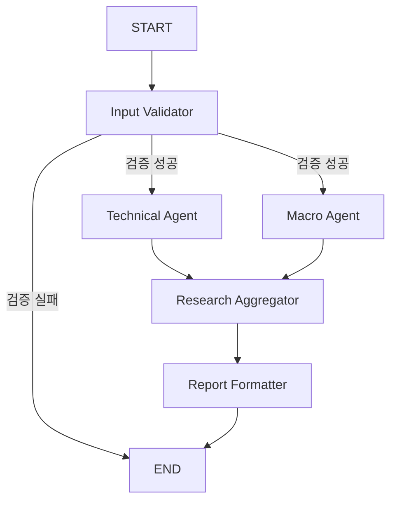

# STEP 10 — 실제 LangGraph / 규칙 기반 Mock 노드

이 문서는 STEP 10 Mock 정책과 당시 검증 기록이다. STEP 11에서 추가한 선택적 LLM 경로와
새 비용/내용 검증 정책은 [역할별 LLM 워크플로우](llm_workflow.md)를 참고한다. 기본 Mock 동작은 유지된다.

검증 환경: Python 3.11, LangGraph **1.2.15**, langchain-core **1.6.10**,
Pydantic **2.14.1**, Streamlit **1.64.0**.
네이티브 Mermaid UI를 검증한 Streamlit 1.64를 requirements의 최소 버전으로 맞췄다.

`requirements.txt`에 LangGraph를 추가했다. 공식 `StateGraph`, `START`, `END`, `compile()`을
사용하고 컴파일된 그래프의 `stream(stream_mode="values")`를 끝까지 실행한다.
이 실행은 실제 LangGraph이며, **노드의 분석 내용은 결정론적인 Mock 규칙**이다.
복수 LLM 호출·토론·투자 성능 검증은 아니다.

## 구조

정상 검증 시 conditional edge가 두 분기를 선택한다. 두 노드는 같은 superstep에서
최대 동시성 2로 실행한다. `add_edge(["technical_agent", "macro_agent"], "research_aggregator")`
형식의 barrier로 **두 분기가 끝난 후 Aggregator가 한 번 실행**되도록 한다.
두 분기의 예외는 오류 결과로 변환되어 합류하므로 한 분기의 실패가 다른 결과를 지우지 않는다.
형제 노드는 공통 `execution_status` 필드를 갱신하지 않는다.

## State와 Runtime

`graph/state.py`의 `WorkflowState(TypedDict)`:

| 필드 | 담당 및 의미 |
| --- | --- |
| run_id, symbol, timeframe | runner가 호출마다 새 UUID/대상 설정 |
| input_data | Validator가 만든 STEP 9의 검증된 MarketSnapshot |
| input_fingerprint, data_as_of_utc | 검증된 요약 해시 및 마지막 확정 봉 마감 |
| technical_result | Technical 노드만 갱신 |
| macro_input, macro_metadata, macro_result | Macro 노드만 갱신 |
| aggregation_result | Aggregator만 갱신 |
| final_report | Formatter가 작성, runner가 전체 소요 시간 확정 |
| node_execution_logs, errors | `Annotated[list, operator.add]`로 병렬 append 병합 |
| execution_status | WAITING / RUNNING / COMPLETED / PARTIAL / FAILED |

실제 DataFrame은 실행별 `WorkflowContext`에 참조로 전달한다. State나 로그에 원본 DataFrame을
넣지 않고 외부 저장소·체크포인트도 사용하지 않는다. STEP 9 입력 생성기가 검증에 필요한
복사를 수행하며, 어댑터 경계에서는 작은 요약만 격리한다. 원본 시장/거시 데이터는 변경하지 않는다.
컴파일된 그래프 구조만 재사용하고, 각 실행의 State와 runtime은 별도다.

## Input Validator

- 종목/봉 지원 목록, 필수 지표 컬럼 존재 여부, Pydantic 입력 스키마 검사
- 수집/지표 메타데이터에 지정된 종목·봉과 현재 요청의 일치 여부 검사
- UTC 시각·원본 수집 시각·OHLCV 범위·수치 유한성·MACD 관계 검사
- 미래 봉/미확정 봉이 들어오면 실패로 종료 (STEP 9의 필터링보다 엄격한 경계)
- 초기 지표 NaN은 자료 부족으로 구분한다. 필수 컬럼 누락/잘못된 가격은 입력 오류다.
- 검증 실패 시 후속 노드를 SKIPPED로 기록하고 정상 리포트를 만들지 않는다.

## Technical Agent

STEP 9의 `build_market_snapshot()`을 재사용한다. 가격·RSI·MACD·EMA/SMA·거래량 등의
실제 입력 값과 근거를 보존한다. 기본 규칙은 다음 **AND** 조건이며 가중치/다수결이 아니다.

- BULLISH: EMA20 > EMA60, SMA20 > SMA60, MACD Histogram > 0, 50 < RSI < 70
- BEARISH: EMA20 < EMA60, SMA20 < SMA60, MACD Histogram < 0, 30 < RSI < 50
- 충분한 입력에서 나머지 상태는 NEUTRAL
- 연속 확정 봉/핵심 지표가 부족하면 INSUFFICIENT_DATA

RSI 30/50/70 경계는 NEUTRAL이다. 거래량 등은 관측 근거로 표시하고 임의 점수로 합산하지 않는다.
근거의 수치는 Python에서 이미 계산된 값이며 새 가격/지표를 생성하지 않는다.

## Macro Agent

기존 FRED 조회를 마친 선택 항목만 재사용한다. 공용 `summarize_macro_frames()`를 STEP 9 입력
생성기에서 추출하여 중복을 피했다. 공용 함수의 계산/반환 정책은 유지했다.
Macro 노드는 가격 DataFrame을 재복사하지 않는다.

관측값·단위·주기·관측일·수집 시각·결측 개수·발표/빈티지 값 존재 여부를 별도로 다룬다.
입력에 발표/빈티지 값이 있더라도 출처와 당시 가용성이 확인되지 않으면 신뢰하지 않는다.
현재 경로는 모두 현재 개정값 문맥이다. 관측일을 발표일로 대체하지 않는다.

- 자료 없음/선택 항목 미조회/유효 관측 없음: 정상 노드 완료 + `INSUFFICIENT_DATA`
- 유효 현재 관측 있음: `CONTEXT_ONLY`, 방향 의견 없음
- 단위·날짜·값 오류/노드 예외: 노드 FAILED, 자료 부족과 구분

Macro가 실패해도 Technical의 유효한 결과는 유지된다.

## Research Aggregator와 Formatter

Aggregator는 두 노드의 종료 기록과 결과를 확인한다. Pydantic 검증뿐 아니라 원본 근거와
Mock 규칙을 다시 대조하여 값·날짜·문장·누락 근거·상태가 변조된 출력을 거부한다.
현재 검증기는 Mock 규칙과 정확히 일치하는 결과를 요구한다. 향후 LLM 어댑터를 연결할 때는
새 근거 검증 정책을 함께 구현해야 하며 인터페이스만 바꿔 실 LLM이 자동 활성화되지는 않는다.

- 시점 미검증 Macro는 최종 방향 판단에 참여하지 않는다.
- 기술적 상승/하락 근거가 동시에 있으면 상충을 명시하고 NEUTRAL로 정리한다.
- Technical 자료 부족은 INSUFFICIENT_DATA로 유지한다.
- Macro 실행 실패 + Technical 정상은 PARTIAL 리포트다.
- Technical 실패 또는 Aggregator 검증 실패는 FAILED이며 정상 최종 리포트가 없다.

Formatter는 실행 ID·모드·대상·자료 마감·출처·요약·상충·위험·부족 항목·한계를 한국어로
작성한다. 실행 시작/종료 시각과 실제 경과 시간을 포함한다. 내부 Chain-of-Thought는
생성·요청·저장하지 않는다. 입력/분석 값은 재현 가능하지만 UUID·실행 시각·처리 시간·
병렬 스케줄 순서는 실행마다 달라질 수 있다.

## 로그와 UI

각 노드는 WAITING → RUNNING → COMPLETED 또는 FAILED 이벤트를 남긴다.
후속 미실행/리포트 생성 생략은 SKIPPED다. 노드명·UTC 시작/종료·소요 ms·오류 분류를 기록한다.
그래프 자체가 중단되어 완료를 확인할 수 없으면 해당 노드를 GRAPH_ERROR/FAILED로 표시한다.
오류 원문·인증 헤더·API 키·원본 비공개 입력은 로그에 보관하지 않는다.

UI는 **실행 후 기록**만 표시하며 실시간 진행 상태라고 표현하지 않는다.
Technical/Macro 상태 카드와 Aggregator/Formatter 카드, Mermaid 그래프, 노드별 결과,
최종 리포트 및 실행 로그를 제공한다. Mermaid 문자열은 로컬 생성하며 원격 이미지 API를 쓰지 않는다.
Bull/Bear/Risk Manager는 NOT CONNECTED다. STEP 9 단일 LLM 분석/AI SIGNAL은 별도로 유지한다.

실행 버튼만 워크플로우를 시작한다. 표시 체크박스/페이지 재실행은 재실행하지 않는다.
종목·봉·기간·입력 값/수집 시각·선택/조회된 Macro가 바뀌면 이전 결과를 무효화한다.
새 Binance/FRED 요청은 기존 버튼/캐시 경로에만 있으며 그래프 자체는 외부 API를 호출하지 않는다.
OpenAI/FRED 키가 없어도 이미 확보한 가격 데이터로 Mock Workflow를 실행할 수 있다.
시장 자료 자체가 없으면 실패 상태로 종료하며 대체 가격을 만들지 않는다.

LangSmith는 설치 의존성에 포함되지만 이 실행은 `tracing_context(enabled=False)`와 빈 callback으로
외부 전송을 비활성화한다. 프로세스 환경변수/보안 설정을 변경하지 않는다.
계속 유지되는 기록은 현재 브라우저 세션의 마지막 실행뿐이며 서버 재시작/세션 종료 시 사라진다.

## 검증 기록 (2026-10-15)

- 신규 테스트 **27개 통과**: 컴파일, END까지 실행, Barrier로 실제 병렬 진행,
  합류 1회, 병렬 오류/로그 reducer, 동시 실행 격리, 입력 오류, 기술 규칙,
  Macro 부족/미검증 빈티지/실패, 근거 변조 거부, 상충, 재현성, 불변성,
  유료/외부 추적 미호출, UI 버튼/캐시/무효화, STEP 9 독립성.
- 전체 pytest **339 passed, 14 skipped**, 하위 검증 **332개 통과**.
  기존 STEP 1~9의 312개 회귀 테스트를 포함한다. 기본 제외 14개는 기존 실 API opt-in 테스트다.
- 실행 서버 `http://127.0.0.1:8503`에서 health 200, 기존 가격 차트,
  실제 Binance 가격과 FRED CPI 조회 후 Technical/Macro/집계 노드 완료를 확인했다.
- 실행 중인 서버의 이전 모듈 캐시로 생긴 import 오류는 8503 서버 재시작으로 해소했다.
  기존 8501 서버는 종료하지 않았다.
- **실제 LangGraph 실행**, **규칙 기반 Mock 노드**, **OpenAI 유료 호출 0회**를 구분한다.
  LangSmith 전송도 없다. FRED 5종은 합성 응답 기반 노드 테스트로 검증했고,
  이번 실행 서버의 실제 FRED 연동 확인은 CPI다.

검증 명령: `.venv\Scripts\python.exe -m pytest -q`.
서버 수동 시작: `.venv\Scripts\python.exe -m streamlit run app.py --server.port 8503`.
기존 포트가 실행 중이면 새 서버를 중복 시작하지 말고 브라우저로 접속하거나 다른 포트를 선택한다.

공식 근거: [Graph API/State/reducers/compile](https://docs.langchain.com/oss/python/langgraph/graph-api),
[병렬 분기 및 list-form 합류](https://docs.langchain.com/oss/python/langgraph/use-graph-api).
