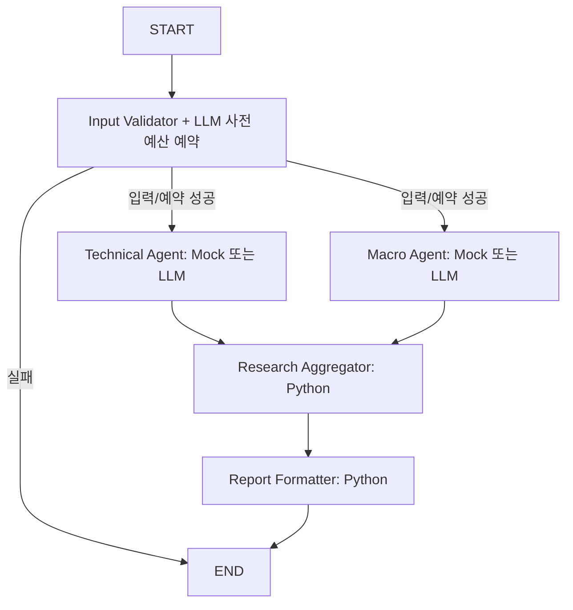

# STEP 11 — 역할별 LLM 워크플로우

기본 **Mock Workflow**는 STEP 10의 결정론적 규칙과 결과를 유지한다. **LLM Workflow**는
동일한 실제 LangGraph에서 Technical/Macro별 공식 OpenAI Responses API를 호출하는 선택 경로다.
개발·자동 테스트에서는 유료 API를 호출하지 않았으며, 실제 계정 권한/과금/응답 품질은 미검증이다.

## 실행 구조와 State



`StateGraph`, `START`, `END`, `compile()`과 두 분기 barrier edge를 유지한다. 최대 동시성은 2다.
공유 State에 `execution_mode`, `technical_execution`, `macro_execution`을 추가했다.
각 실행 상세에는 모델, 실제 전송 여부, 검증 상태, 입력/출력/합계 토큰, 사용량 기반 추정 비용,
미확인 예약 비용, 오류 유형이 있으며 처리 시간은 기존 NodeLog에 기록한다.
병렬 노드는 자기 결과/실행 상세만 쓰고 로그/오류는 append reducer로 합친다.
키·원장·예약·원본 DataFrame은 실행별 runtime에만 보관하고 State/로그에는 넣지 않는다.
LangSmith 원격 추적 및 체크포인트는 사용하지 않는다.

## 역할별 입력과 출력

- Technical: STEP 9의 검증된 MarketSnapshot 재사용. 자산/봉, 확정 시각/종가/변화율,
  RSI/MACD/Signal/Histogram, EMA/SMA, 거래량, 수집 시각, 누락/품질 요약만 전송한다.
  원시 시계열 전체는 전송하지 않는다.
- Macro: 이미 조회한 선택 FRED 자료만 사용한다. 값/단위/주기/관측일/수집 시각,
  관측/결측 수와 발표/빈티지 기록 존재 여부를 보낸다. 발표/빈티지의 신뢰성은 여전히 `unknown`이다.
  관측일을 발표일로 바꾸거나 현재 개정값을 과거 가용값으로 가정하지 않는다.
- 전용 `TechnicalLLMOutput`/`MacroLLMOutput` Pydantic 스키마와 별도 프롬프트를 사용한다.
  Technical은 방향·요약·양방향 요인·근거 ID/값/관측 시각·위험·한계를 반환한다.
  Macro는 현재 관측 문맥·근거·위험·한계·`CONTEXT_ONLY/INSUFFICIENT_DATA`만 반환한다.
- Technical 핵심 데이터가 부족하거나 유효 Macro가 없으면 해당 유료 호출을 생략하고
  로컬 `INSUFFICIENT_DATA`를 만든다. `api_called=False`, `LOCAL_DATA_CHECK`로 구분한다.
  LLM 모드를 선택했더라도 로컬 결과를 실제 LLM 응답으로 표시하지 않는다.
- Macro 수집/입력 오류는 자료 부족으로 숨기지 않는다. 해당 분기는 실패하되 Technical은 유지한다.

## 형식과 내용 검증

SDK의 `responses.with_raw_response.parse(text_format=...)`로 형식을 검증한 뒤 별도 내용 검증을 한다.
모든 역할별 근거 ID는 허용된 원본 ID와 정확히 대응해야 하며 중복/누락/다른 자료 인용을 거부한다.
각 근거의 수치·출처·이름·관측 시각·설명은 Python 입력과 정확히 같아야 한다. 오류를 임의 보정하지 않는다.
Aggregator에서도 정규화된 결과를 다시 검증한다.

사실성 검사 범위를 명확히 하기 위해 STEP 9와 같은 **문장 카탈로그 선택 방식**을 사용한다.
요약·위험·한계는 허용 문장, 상승/하락 요인은 원본 지표의 해당 방향 문장으로 제한한다.
상충하는 자료가 있으면 양쪽 요인을 반드시 포함한다. 자유 서술의 사실성을 보장한다고 주장하지 않는다.
LLM은 충분한 데이터에서 NEUTRAL 또는 검증된 지표의 AND 방향 조건에 부합하는 의견만 선택할 수 있다.
잘못된 방향, 새 수치/시각/사건, 주문 지시, 확률/승률 필드는 거부한다.
이는 보수적인 출력 계약이며 자유로운 경제 해석이나 검증된 예측 모델이 아니다.

Aggregator는 LLM을 호출하지 않는다. Macro는 방향 결정에 참여하지 않고, 기술적 양방향 근거가
있으면 상충을 기록해 NEUTRAL로 통합한다. Technical 부족은 INSUFFICIENT_DATA다.
Macro 실패+Technical 정상은 PARTIAL, Technical/집계 검증 실패는 FAILED이며 정상 최종 리포트를 만들지 않는다.
개별 정상 분기 결과와 실제 실행 기록은 실패 상태에서도 유지한다.

## 비용과 API 게이트

STEP 9의 `llm/client.py` 전송 경로와 `_ai_ledger: UsageLedger`를 그대로 공유한다.
새 API 클라이언트/별도 세션 예산을 만들지 않는다.

1. 명시적 실행 버튼, LLM 모드, 비용 승인, 본인 API 키, 검증된 모델/가격이 모두 필요하다.
   페이지 로딩·지표 토글·모드 선택·승인 체크만으로는 API를 호출하지 않는다.
2. 기본 세션 상한 **5 HTTP 시도/$0.25**, 출력 기본 3,000토큰(상한 5,000), 역할별 입력 본문
   24,000 UTF-8바이트다. STEP 9 ‘AI 요청·비용 설정’을 함께 사용한다.
3. Validator 이후 실제 호출할 분기들의 비용/횟수를 `RLock` 아래 **일괄 예약**한다.
   두 호출 전체가 예산에 들어가지 않으면 둘 다 전송하지 않는다. HTTP 대기 중에는 lock을 해제해 병렬 실행한다.
4. 예약 추정은 입력/프롬프트/엄격 스키마 UTF-8바이트+프레이밍 여유와 최대 출력 토큰을 사용한다.
   정확한 토큰 수라고 표시하지 않는다. 실제 API usage가 있으면 사용량 기반 비용으로 바꾼다.
5. 인증/권한, Rate Limit, 타임아웃/네트워크, HTTP, 미완료/거절, 스키마, 내용 검증 오류를 분리한다.
   SDK와 Workflow의 **자동 재시도는 모두 0회**다. 과금 불명 실패는 예약 비용을 유지한다.
6. 그래프 중단 등으로 전송하지 않은 것이 확인된 RESERVED만 취소한다.
   ATTEMPTED 요청은 미전송/무료라고 가정하지 않는다.
7. 동일 모델/키 범위/입력/프롬프트 요청은 60초간 중복 차단한다. 예산 예약 실패는 중복 기록을 남기지 않는다.
8. 가격은 기존 설정의 확인일로부터 30일 이내만 사용한다. 미확인/만료 가격은 호출 차단한다.
   세금·지역별 요금·할인 등을 확정하지 않으며 세션 원장은 계정 결제 상한을 대체하지 않는다.
   새 브라우저 세션/서버 재시작 시 원장이 초기화된다.

## UI와 실행

기존 STEP 9 단일 LLM/AI SIGNAL은 유지된다. Multi-Agent 영역에서 두 모드를 구분하고,
LLM 모드에서만 모델/예약 추정 상한/비용 승인 체크박스를 보여준다.
선택 모드·모델/키 범위·설정·시장/거시 입력이 바뀌면 이전 결과를 무효화한다.
모델/키/출력/예산/종목/봉/기간 변경 시 비용 승인을 다시 받는다.
기존 자료 캐시를 사용하며 FRED/Binance 재조회나 API 키 발급을 수행하지 않는다.
노드별 실제 호출 여부/사용량/상태와 **실행 후 로그**를 보여준다. 실시간 진행이라고 표현하지 않는다.
Bull/Bear/Risk Manager는 NOT CONNECTED다. 비공개 내부 추론은 요청·보관하지 않는다.

```powershell
.\.venv\Scripts\python.exe -m streamlit run app.py --server.port 8505
.\.venv\Scripts\python.exe -m pytest -q
```

기존 8501~8504 서버와 충돌하지 않도록 이번 검증 서버는 `http://127.0.0.1:8505`를 사용했다.
기본 Mock 모드에는 OpenAI 키가 필요 없다. 실제 LLM 실행은 본인의 `.env` 키와 UI 비용 승인이 필요하다.

## 공식 지원 확인

검증 환경: Python 3.11, OpenAI SDK **2.54.0**, Pydantic **2.14.1**, LangGraph **1.2.15**,
Streamlit **1.64.0**. 기존 설치 패키지를 재사용했으며 새 의존성은 추가하지 않았다.
기본 모델은 `gpt-5.4-mini-2026-03-17`이며 `OPENAI_MODEL`로 기존 허용 목록 내에서 변경한다.
Responses/Structured Outputs/`reasoning.effort=none` 지원과 표준 텍스트 입력 $0.75/출력 $4.50 per 1M tokens는
2026-10-15 [공식 모델 문서](https://developers.openai.com/api/docs/models/gpt-5.4-mini)에서 확인했다.
Pydantic parse 사용법은 [공식 Structured Outputs 문서](https://developers.openai.com/api/docs/guides/structured-outputs?api-mode=responses)를 따른다.
공식 지원 확인과 실제 사용자 계정에서의 호출 성공은 다른 검증이다.

## 검증 결과

모의 HTTP와 합성 입력으로 실제 SDK 파싱/StateGraph 분기·합류, 근거 오류, 자료 부족/부분 실패,
무승인 차단, 동시성 예산, 중복 실행, 인증/한도/타임아웃, UI 버튼/캐시/무효화,
STEP 9 공유 원장 및 STEP 10 Mock 결과 보존을 검증한다.
최종 전체 pytest: **373 passed, 14 skipped, 361 subtests passed** (106.14초).
이번 단계 신규 테스트는 34개이며 기존 STEP 1~10 회귀 테스트를 함께 통과했다.
14개 건너뜀은 기존 선택적 Binance/FRED 실 API 테스트이며, 이번 실행에서 활성화하지 않았다.
Python 소스 98개 문법 검사, 별도 프로세스 전체 로컬 import 테스트, `pip check`, `git diff --check`도 통과했다.

실제 Streamlit 서버는 HTTP 200/health ok와 WebSocket 렌더링을 확인했다.
처음 격리 실행에서는 Binance 소켓 연결이 거부되어 시세가 없었다. 허용된 네트워크 실행 환경에서
같은 8505 서버를 다시 시작한 후 **실제 시장 차트 1개와 Mock Workflow 버튼의 COMPLETED**를 확인했다.
이 문제로 데이터 수집/백테스트 코드를 변경하지 않았다.
LLM 경로는 공식 SDK를 `httpx.MockTransport`에 연결한 모의 응답 검증이며 실제 유료 OpenAI 호출은 수행하지 않았다.
문장 카탈로그 제약, FRED 발표/빈티지 부족, 계정 권한/청구액/LLM 응답 품질 미검증이 남는다.
