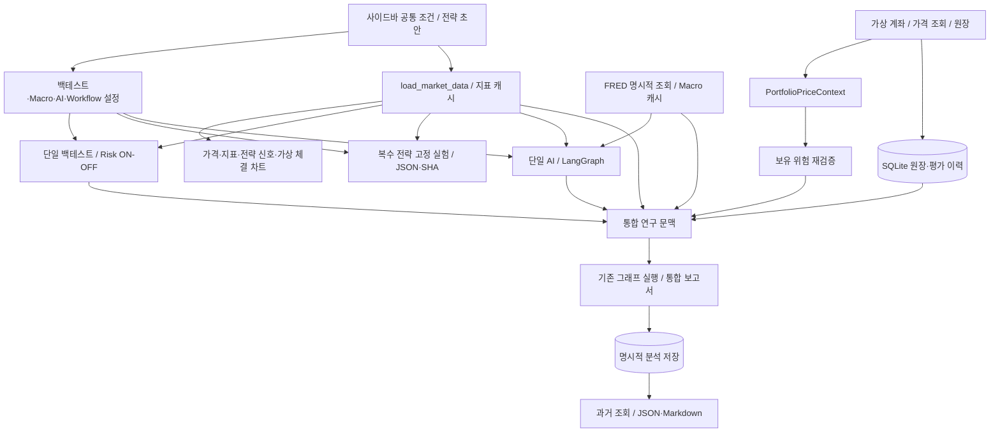

# R01 — 리디자인 기준선과 보호 계약

기록일: **2026-11-12 (Asia/Seoul)** · 기준 기능 커밋: **`4266787`** · 상위 작업: **SF-POST-01 / R01**

**R01 완료: 계약/의존성 조사·기존 전체 회귀 재실행·합성 고정 기준 확보. UI 디자인/배치와 엔진은 변경하지 않았다. R02~R08은 구현 미착수다.**

## 1. 조사 범위와 작업 전 상태

- 기존 [리디자인 계획](../UI_UX_REDESIGN_PLAN.md), [백로그](../BACKLOG.md), [CHANGELOG](../CHANGELOG.md), [README](../../README.md), `app.py`, `ui/` 20개 모듈과 관련 테스트·저장/복원·LLM 예산·그래프·계산 코드를 확인했다.
- 작업 시작 시 `docs/BACKLOG.md` 수정과 미추적 `docs/UI_UX_REDESIGN_PLAN.md`, 별도의 기존 미추적 파일 1개가 있었다. 이 변경/파일을 보존했다. 기존 미추적 파일은 이번 작업 산출물이 아니다.
- 키/`.env` 내용을 조사 자료로 출력하지 않았다. 사용자 SQLite는 저장소로 열지 않고 보존 확인용 읽기 전용 파일 지문만 확보했다. 데이터 생성/저장/복원은 합성 입력과 `.pytest_cache`의 별도 시험 DB에서만 수행했다.
- 설치 환경은 Windows / Python **3.11.9**, Streamlit **1.64.0**이다. 신규 라이브러리 설치·의존성/보안 설정 변경·유료 LLM·실제 주문·Git 커밋/Push는 없다.

조사·분류·검증 산출물:

| 산출물 | 용도 |
| --- | --- |
| [기능 정리 후보](R01_FEATURE_REVIEW.md) | 현재 위치/목적/중복·의존성/제거 영향/추천 분류 |
| [UI 상태·실행 키 목록](R01_UI_STATE.md) | `app.py`와 20개 UI 모듈의 함수·정적 Session State/위젯 키 표현식 |
| [고정 manifest](../../tests/fixtures/redesign_r01/manifest.json) | 11개 계산 파일·78개 백엔드 소스 지문, 환경·시험 SQLite 스키마·12회 성과 기준 |
| [합성 실험 JSON](../../tests/fixtures/redesign_r01/synthetic_experiment.json) | 기존 STEP 18 표준 내보내기 형식의 입력+기준 결과 SHA |
| [합성 원장 JSON](../../tests/fixtures/redesign_r01/synthetic_account.json) | 원금/거래/가격·예상 손익·최종 원장을 포함한 손계산 예제 |
| [전용 검증 도구](../../scripts/verify_redesign_baseline.py) | 고정 자료를 읽어 재검증. 기준 재생성/덮어쓰기 옵션 없음 |

## 2. 현재 호출 관계와 상태 의존성



이 그림은 자료 의존성 요약이다. 세 AI 경로는 서로 다른 명시적 실행이며, 모두를 한 번의 자동 분석으로 묶어 실행한다는 뜻이 아니다.

| 경계 | 현재 실제 연결 | 화면 분리 시 지켜야 할 조건 |
| --- | --- | --- |
| 시장/지표 | `services.market_data.load_market_data()`가 수집→지표 계산→표시 구간을 캐시 | 표시 토글은 캐시 키에 추가하지 않음. TTL/수집/워밍업 상한 유지 |
| 전략/백테스트/실험 | 전략 빌더가 반환한 `Strategy`와 백테스트 `BacktestConfig/RiskConfig`를 공유 | 현재 편집 초안과 비교 목록의 고정 JSON을 구분. 비용/Risk를 페이지별 기본값으로 덮어쓰지 않음 |
| 가격/보유 위험 | `render_portfolio()` 반환 `PortfolioPriceContext` → 키워드 인자 `render_portfolio_risk(price_context=...)` | 계좌 ID/revision·quotes/frames·동일 평가 UTC를 전달하고 다시 검증 |
| 같은 이름의 세션 값 | `_portfolio_price_context`는 현재 `(timeframe, period)` 튜플 | 이 값을 `PortfolioPriceContext` 객체로 잘못 전달하지 않음 |
| 평가 이력/보고서 | 계좌 이력 렌더러가 `_portfolio_history`를 채우고 통합 문맥에서 읽음 | 이력 화면을 먼저 방문하지 않아도 필요한 검증 이력이 준비되도록 UI 조립을 정리 |
| 통합 문맥 | `current_research_context()`가 계좌/가격·전략·백테스트 설정·Risk와 서명을 읽음 | 비활성 화면의 이전 상태/서명에만 의존하지 않음. 기존 실제 입력 변경 검사는 유지 |
| 과거 결과 | `_restored_analysis`와 `_research_snapshot`을 분리 | 과거 조회는 현재 계좌/보고서를 덮어쓰거나 API를 다시 호출하지 않음 |
| 오프라인 진입점 | `demo/offline.py`의 주입 범위 안에서 실제 `app.py` 실행 | 새 탐색/선택 화면도 범위 안에서 실행. 합성 배너·세션 시험 DB·잠금·통신 차단 유지 |

## 3. 화면별 Session State 보호

전체 정적 표현식은 [목록](R01_UI_STATE.md)에 있다. 이 목록은 실제 값/키·개인 자료를 덤프한 것이 아니며 동적 키의 모든 실행 조합을 완전 열거하지 않는다.

| 상태군 | 대표 키 | 보호/수명 |
| --- | --- | --- |
| 시장/표시 | `symbol/timeframe/period`, `show_*`, `macro_*` | 공통 선택 보존. 표시 토글을 계산 변경으로 취급하지 않음 |
| 전략 | `_strategy_draft`, `_strategy_revision`, `strategy_name`, 방향/조건 행별 키 | 미저장 초안·행 ID·AND/OR 유지. 페이지 이동으로 재초기화 금지 |
| 백테스트 | `bt_*`, `risk_*`, `_backtest_key/result`, `_risk_comparison` | 유효한 입력의 결과 보존, 실제 전략/가격/비용/Risk 변경은 무효화 |
| 실험 | `_experiment_strategies/current/replay`, `_experiment_replay_reference*`, 업로드 digest, `exp_*` | 현재/과거 재현·기준 SHA를 구분. 업로드 변경/제거 시 이전 재현 무효화 |
| 거시/통계 | `_macro_results/signature`, `_cm_result/signature`, `macro_*`, `cm_*` | 기간/변환/자격 변경 검사 유지. 선택된 검증 자료만 AI에 전달 |
| AI/Workflow | `_ai_result/signature`, `_workflow_execution/signature`, `_debate_last_attempt`, 모드·Debate/Risk 키 | 각 실행 결과/실패를 독립 보존. 세 경로의 모드·승인을 혼용하지 않음 |
| 비용 | `_ai_ledger`, 각 `_approval_signature`와 승인 체크 | 같은 세션 전체에서 공유. 메뉴 전환으로 초기화/한도 리셋 금지. DB 영속 복원 금지 |
| 계좌 | `_portfolio_account/revision/nonce/autoloaded`, `pf_*` | 저장 성공 후 반영·중복 이벤트/경합 방어. 자동 새 계좌/거래 생성 금지 |
| 가격/보유 위험 | `_portfolio_frames/valuation/history`, `_portfolio_risk*`, `pr_*` | 원본 가격·확정 마감/수집 시각·가정 재검증. 없으면 UNKNOWN/N/A |
| 통합/복원 | `_research_signature/execution/snapshot`, `research_*`, `_restored_analysis/generation` | 실제 입력 변경 무효화·저장 당시 스냅샷·현재/과거 구분·개발자 메뉴 기본 닫힘 |

Streamlit은 숨김/페이지 이동으로 위젯 수명을 바꿀 수 있다. R03 전에는 공통 위젯과 페이지별 위젯·별도 애플리케이션 상태를 구분해야 한다. 버튼/폼 제출은 단발 이벤트이며, 이전 클릭을 복원해 자동 거래/분석/저장을 만들면 안 된다. 파일 업로더도 일반 입력 위젯과 같은 방식으로 대입/복원하지 않는다. 동적 전략 행은 기존 revision 기반 키 교체 동작을 보존한다.

### 결과 무효화의 서로 다른 계약

1. 백테스트 `result_fingerprint()`는 전략/원금/비용/유효 Risk·시장/버전·DataFrame 값/인덱스/컬럼을 비교한다.
2. 기본 Workflow `input_signature()`는 수집 시각도 구분한다.
3. 통합 리포트는 `include_collection_time=False`를 사용한다. 같은 관측의 유효한 재수집 시각만 달라졌다는 이유로 저장 전에 보고서를 삭제하지 않는다. 실제 값/전략/모드/원장/가정/메모 변경은 계속 무효화한다.
4. 실험 `current_input_key()`는 수집 시각/확정 여부를 검증한 뒤 같은 값의 재수집 시각을 제외한다. 등록 전략·비용/Risk·구간·품질·코드 변경은 반영한다.
5. 보유 위험은 계좌 revision·평가/가격·가정/관측 이력 서명을 검사한다. STEP 14에서 가격 숫자가 보인다는 이유만으로 유효성을 우회하지 않는다.

페이지를 다시 열 때도 해당 검사를 수행한다. 하나의 범용 지문으로 합치거나, UI 메뉴/색상 같은 표시 상태를 기존 계산 지문에 넣지 않는다.

## 4. 계산·체결·위험관리 보호 계약

기존 [백테스트 계약](../backtesting.md), [Risk 체결 규칙](../risk_management.md), [엔진](../../backtest/engine.py)을 확인했다.

- 모든 신호는 확정 봉 기준이며 **다음 연속 봉 시가**에 체결한다. 다음 봉이 누락되면 뒤의 봉으로 대체하지 않고, 마지막 신호는 미체결이다.
- 한 종목·한 포지션 FLAT/LONG/SHORT, 반대 신호는 기존 포지션 청산만 수행한다. 같은 신호로 즉시 반대 진입하지 않는다. 마지막 열린 포지션은 종가 평가하고 실현/미실현을 구분한다.
- 기본 원금 10,000 USDT, 편도 수수료 0.1%, 슬리피지 0.05%, 직전 확정 봉 거래량 참여율 10%다. 체결 봉의 아직 알려지지 않은 거래량으로 시가 체결 크기를 정하지 않는다.
- 매수/매도의 불리한 슬리피지·진입/청산 비용·현금/수량/Equity 회계를 유지한다. 전량 청산의 거래량 부족 정책과 Risk 재시도는 기존 엔진 그대로다. 부분 체결을 새로 만들어내지 않는다.
- Risk 우선순위는 미체결 리스크 재시도 → 시가 갭 리스크 → 신호 시가 청산 → 봉 내부 리스크다. 동시 손절/익절은 손절 우선, 손절/트레일링은 더 불리한 기준을 쓴다.
- 트레일링은 직전 봉까지의 극값만 현재 봉에 적용한다. 진입 봉의 OHLC 경로/정확한 봉 내부 체결 시각은 안다고 가정하지 않는다.
- 승률의 분모는 종료 거래다. 무거래 0과 승률/평균 손익 N/A, 종가 기반 MDD, 초기 지표 NaN·충돌·불충분 자료를 구분한다.
- 가상 SHORT는 실제 Binance Spot 주문이 아니다. 포트폴리오는 무레버리지 양수 보유이며 AI Risk Manager의 교육용 레버리지 계산과 다르다.

### Risk 설정은 세 가지 의미를 보존

| 설정 | 실제 목적 | 통합 가능한 부분 / 합칠 수 없는 부분 |
| --- | --- | --- |
| `BacktestConfig/RiskConfig`, `bt_*`, `risk_*` | 역사적 체결 비용/참여율·손익절·트레일링 | 단일/복수 백테스트가 같은 설정 원본 사용. 시간별 체결 규칙 유지 |
| `PositionSettings`, `rm_*` | 원금·허용 손실·손절 거리·레버리지로 가상 노출/왕복 비용 평가 | 기존 ‘백테스트 설정 가져오기’처럼 명시적 가져오기는 유지. 백테스트 계좌/실보유량과 동일 상태로 자동 동기화하지 않음 |
| `PortfolioRiskSettings`, `pr_*` | 실제 가상 보유량의 집중도·가격 충격·가정 매도 비용·계좌 한도 | 설정 패턴/단위 표시는 통일 가능. 실제 보유량/충격률을 RM 손절률/레버리지로 대체하지 않음 |

## 5. STEP 18 입력·결과 해시와 고정 기준

기존 알고리즘은 변경하지 않았다. `backtest-experiment-v1`, `experiment-result-sha256-split15-v1`, 앱 내부 버전 `0.18.0`을 유지한다.

- [CODE_FILES](../../backtest/experiments.py)의 **11개 계산 파일**은 LF 정규화 UTF-8 소스로 지문을 만든다. `config/settings.py`도 포함되므로 표시명 변경만으로 기존 실험을 거부하게 될 수 있다.
- R01 manifest에는 별도로 **78개 백엔드 Python 소스**의 LF 지문도 고정했다. 이는 UI 리디자인 중 수집/전략/포트폴리오/저장/LLM/그래프 계약 변경을 발견하기 위한 검증 도구의 기준이다. 기존 실험의 해시 알고리즘을 확장한 것이 아니다.
- 입력은 고정 OHLCV/전략 JSON·비용/Risk·기준 UTC·구간·품질·계산 코드/버전을 보존한다. 전략별·Risk별·구간별 독립 초기 상태/초기금을 유지한다.
- 결과 SHA는 조합 정렬 후 성과·최종 포지션·Equity/거래/체결 이벤트·오류를 비교한다. 표는 pandas split/UTC ns/정밀도 15로 정규화하며 임의 실행 ID/소요 시간은 제외한다.
- 동일 입력/알고리즘·완전 성공끼리 MATCH/MISMATCH를 판단한다. 기준 없음/다른 입력·알고리즘/실패·부분 실패는 UNAVAILABLE이다. 저장 기준 SHA를 재실행 결과로 덮어쓰지 않는다.
- 기존 입력 전용 JSON과 새 기준 포함 artifact를 모두 유지한다. 결과 8MB 초과 시 표/곡선/원장·입력 JSON은 유지하고 해시/Markdown은 N/A다.

### 이번에 실제 확보한 합성 기준

외부 시세가 아니다. 기존 손절 검산 fixture의 **8개 1시간봉**, 전략 2개·손절 1%·원금 1,000·편도 수수료 0.1%/슬리피지 0.05%, 분할 4/4, 고정 기준 `2026-02-01T00:00:00Z`로 12회 실행했다. 초기 지표 부족은 그대로 두고 종가 조건을 사용한다.

| 항목 | 실제 검증 값 |
| --- | --- |
| 계산 코드 digest | `70420772fa7367bdd59529c7ab563571db843f9aa20bd30865f1afbf5c2aaeea` |
| 고정 입력 SHA-256 | `f9663443b4970660fe9ecbd1ed1dbce3b28bd1cde4d166cd54ba99e2a724b97c` |
| 고정 결과 SHA-256 | `0f10cd796475bbc10c6e9b98126065d2a06e3db8b016d453340949cf6f68149d` |
| 저장 입력 재실행·반복 실행 | 12회 COMPLETED / **MATCH**, 반복 결과 SHA 동일 |
| 기준 변조/기준 없음 | 각각 **MISMATCH / UNAVAILABLE** 검출 |
| 손절 발동 | Risk ON의 종료 거래 중 **STOP_LOSS 8건** |
| 합성 전체 구간 전략 A 최종 자산 | OFF **1,038.441818052013** / ON **975.211485672265** USDT |

12개 조합의 전체 성과값은 manifest에 있다. 이 fixture는 Risk 동작/비용·재현성 검증용이며 수익성 평가나 사용자 실 BTC 파일의 재검증 결과가 아니다. 과거 실제 BTC 수동 확인은 STEP 18 개발 기록과 구분한다. SHA는 인증/암호화나 투자 성과 보증이 아니다.

## 6. SQLite·원장·보고서 계약

실제 사용자 DB에 SQL을 실행하지 않았다. 현재 소스와 **새 합성 시험 DB**를 대상으로 아래 구조를 확인했다.

| v1 테이블 | 컬럼 | 키/역할 |
| --- | --- | --- |
| `metadata` | version | 지원 버전 1. 미지원/다른 저장소는 DDL 전에 거부 |
| `accounts` | id, revision, payload, hash, updated | 계좌 ID·원장 revision·무결성·최신 순서 |
| `events` | account_id, id, payload | 계좌/이벤트 복합 키·내용이 다른 동일 ID 거부 |
| `analyses` | id, payload, hash | 분석 ID·검증된 스냅샷·동일 ID 변경 거부 |
| `valuations` | account_id, revision, as_of, payload, hash | 계좌/원장/평가 시각별 복합 키·검증된 관측 이력 |

- `BEGIN IMMEDIATE`·commit/rollback·매개변수 SQL·revision 경합 검사와 원장 재생 검증을 유지한다. 표시 화면을 합친다고 저장소/스키마를 합치지 않는다.
- 원장의 현금/수량은 이벤트로 다시 계산한다. 단순 세션 캐시 값을 DB 원장 대신 신뢰하지 않는다. 동일 이벤트/분석의 반복 저장은 중복 기록을 만들지 않는다.
- 원장 1MB/스냅샷·실험 JSON 8MB·고유 키/유한 수치/깊은 JSON·허용 컬럼·보안 필터를 유지한다. 손상 자료를 삭제/자동 초기화하지 않는다.
- 과거 보고서는 실행 ID/자료 시각/모드/근거를 그대로 조회한다. UI 번역/메뉴 경로/테마를 원본 JSON에 추가하거나 값/정밀도를 바꾸지 않는다.
- 저장/복원·Markdown/JSON 버튼은 기능별 payload가 다르다. 한 공통 이력 화면에서 다루더라도 원장 복원·현재 Workflow 저장·통합 보고 저장을 서로 대신 실행하지 않는다.

### 손계산·백업 복원 기준

합성 원금 1,000 USDT에서 가격 100에 BTC 2개 매수, 110에 1개 매도, 잔여 1개를 120으로 평가했다. 수수료는 양쪽 1%, 슬리피지는 0이다. 고정 UTC 매수 10:03·매도 11:03·평가 12:03에 각 시점의 정시 확정 마감 가격을 사용해 거래/관측 시점을 구분했다.

```text
현금 = 1,000 - 2×100×1.01 + 1×110×0.99 = 906.9
실현 손익 = -2 + (110-100) - 1.1 = 6.9
미실현 손익 = 1×(120-100) = 20
총자산 = 906.9 + 120 = 1,026.9 = 1,000 + 6.9 + 20
총수수료 = 3.1 / 잔여 BTC = 1 / 평균 매입가 = 100
```

전용 도구에서 이 수치를 검증하고 같은 원장의 두 번 저장에도 **revision 2/이벤트 2건**, 평가 저장·표준 `backup()`·새 `LocalStore` 연결의 원장/평가 복원 일치를 확인했다. 시험 DB 경로는 생성 UUID의 `.pytest_cache/r01-validation/` 아래다. 원본 DB를 백업/교체/마이그레이션한 것은 아니다.

통합 보고서의 근거 재검증·저장/복원/임시 DB 백업은 기존 `test_system_integration.py`, `test_research_report.py`, `test_research_ui.py` 회귀를 재실행했다. LLM 응답이나 임의 실행 ID/로그 시간을 결정론적 숫자 결과와 같은 의미로 고정하지 않는다.

## 7. 유료 LLM·실 API·Mock의 경계

| 경로 | 실제 계약 |
| --- | --- |
| 일반 시장/FRED | 공개 시장 자료와 사용자 FRED 키. 실패를 합성으로 대체하지 않음. 확정 UTC·관측일/발표일/빈티지 구분 |
| 단일 AI Mock | 검증 입력 기반 가상 응답/근거 부족 처리, OpenAI 미호출 |
| 단일 AI Live | 실행 버튼·해당 비용 승인·키·가격/입력 검증·예산 예약 필요. 추가 시도 0/1 선택을 별도 예약 |
| Mock Workflow | 실제 StateGraph 병렬/합류, 규칙 Technical/Macro·선택 Mock Debate/Risk. LLM 협업으로 표시하지 않음 |
| LLM Workflow | 기존 Technical/Macro의 선택 유료 호출, Macro 자료 없으면 생략. Debate/Risk의 LLM 호출은 지원하지 않음. 자동 재시도 0 |
| 통합 리포트 | Mock는 기존 그래프 Debate/Risk, Live는 검증된 Technical/Macro. 동일 자료의 별도 Mock 첨부는 실행 ID/시점을 구분. 보고서 조립은 Python |
| 오프라인 시연 | 가격/Macro도 합성. 별도 프로세스·시험 계좌·HTTP/SDK 차단. 일반 시장/API 성공의 근거 아님 |

`_ai_ledger`는 세 분석 UI가 공유한다. 기본 5회/$0.25, 입력/출력 한도·지원/유효 가격, 60초 중복 검사·실패 예약 유지, 병렬 `reserve_many()`의 RLock/전체 선예약을 유지한다. 미전송 예약 취소와 전송/과금 불명 실패를 구분한다. 실제 계정 결제 한도와 같다고 표시하지 않는다.

현재 단일/Workflow/통합은 서로 다른 mode·approval signature·결과 스키마다. UI를 한 연구 화면으로 묶어도 호출을 묶거나 공통 승인으로 여러 실행을 자동 허용하지 않는다. 저장 이력으로 승인/예산/키를 복원하지 않는다. 개인정보/사용자 메모·원장을 LLM에 새로 전송하지 않는다.

## 8. 이번 실제 실행 결과

| 검증 | 결과 |
| --- | --- |
| 기존 전체 pytest 재실행 | **646 passed / 0 failed / 14 skipped / 451 subtests passed** · **314.13초** |
| 기존 시험 변경 | 없음. 새 pytest 수집 항목/skip 추가 없음 |
| 고정 합성 도구 | 11개 계산 소스·78개 백엔드 지문 동일, 12회 결과 MATCH·반복 동일, MISMATCH/UNAVAILABLE 구분, NEXT_OPEN·손절 8건 |
| 기준선 방어 확인 | 고정 fixture 내용과 계산 소스 기준 SHA를 바꾼 **시험용 사본 2종을 각각 거부**. 원본 fixture/소스는 변경하지 않음 |
| 원장·시험 SQLite | 손계산·중복 저장·v1 스키마·백업/새 연결 원장·평가 복원 PASS |
| 실 API | 기존 opt-in 14개 미실행: Binance 계열 9개·FRED 3개·통합 2개. 통과에 합산하지 않음 |
| 실제 유료 LLM/주문 | 실행하지 않음. 기준선 도구에는 HTTP/SDK/기본 사용자 저장소 호출 차단 설치 |
| 실제 새 브라우저 검수 | 이번 R01에서 미실행. 기존 AppTest/합성 통합 회귀와 과거 Edge/사용자 확인은 구분 |
| 작업 전후 보존 | 기존 UI/엔진/테스트/잠금 파일과 사용자 SQLite의 파일 지문 동일. 기존 파일 변경은 BACKLOG·CHANGELOG·미커밋 리디자인 계획의 진행 기록뿐이며 삭제 파일 없음 |

문서 정적 검수 중 PowerShell 파이프로 생성한 상태 목록의 한글이 물음표로 변환된 것을 확인해 UTF-8 파일 기반 생성으로 수정했다. 기능/엔진 오류는 아니며, 최종 목록의 한글·링크·키 분류를 다시 확인했다. 새 검증 도구의 최초 실행과 기존 pytest에는 실패가 없었다.

```powershell
.\.venv\Scripts\python.exe -X utf8 -m pytest -q --tb=short -ra
.\.venv\Scripts\python.exe -X utf8 scripts/verify_redesign_baseline.py
```

도구는 고정 입력을 읽어 기존 함수를 호출한다. 기준 파일은 자동 갱신하지 않는다. 불일치가 나면 원인/환경/변경 파일을 조사하고, 통과를 위해 기준 SHA를 바꾸지 않는다. 동일 Windows/Python3.11·잠금 의존성 조합을 우선한다. 환경 버전과 모든 조합의 성과는 manifest에서 확인한다.

별도 Python 프로세스에서 도구를 다시 실행해 같은 입력/결과 SHA와 복원 PASS를 확인했다. fixture 검증은 UTF-8/LF 정규화 텍스트 지문을 사용하므로 Git의 CRLF/LF 변환만으로 실패하지 않게 했다. 기존 STEP 18 입력/결과 해시 계산을 변경한 것은 아니다. manifest와 fixture를 함께 악의적으로 바꾸는 행위를 인증/방지하는 전자서명은 아니다.

**검증 범위:** 전용 도구는 기존 계산/저장 함수에 고정 입력을 직접 전달한다. 향후 새 UI가 잘못된 수수료/전략/기간을 전달하는 오류나 페이지 이동의 상태 손실까지 이 도구만으로 검출한다고 주장하지 않는다. R03~R07에서는 AppTest/실제 화면에서 설정→입력 스냅샷→실제 결과의 연결을 별도로 대조해야 한다. R05는 고정 JSON 업로드 재현뿐 아니라 현재 UI 설정으로 새로 실행한 비교의 전달값도 검증한다.

## 9. R02~R08 진행 게이트

| 단계 | 진입 전 필요한 검증 / 통과 기준 |
| --- | --- |
| R02 공통 디자인 | 이번 고정 기준 재검증, 새 표시 토큰을 계산 설정과 분리. 숫자·단위/상태·현재/과거·실제/합성 표시 보존. 엔진/DB/키 변경 없음 |
| R03 탐색/세션 | 전략 초안/비용/모드/계좌/업로드/공유 원장 왕복 유지, 단발 이벤트 재실행 0, 현재 문맥 준비·활성 화면만 실행 |
| R04 시장/거시 | 지표/축/마커/UTC·관측일 의미 동일, 캐시 유효 시간 내 표시 토글 추가 조회 없음, 부족/오류를 N/A로 유지 |
| R05 백테스트/실험 | 고정 12회 SHA/성과·next-open·손절 원장 동일, 기준/현재 설정 독립, 현재/과거 업로드/8MB 회귀 |
| R06 계좌/저장 | 고정 손계산/스키마/복원·중복/경합·가격 문맥 검증, 원본 데이터 불변 |
| R07 AI/보고 | 세 경로·공유 비용·버튼 승인·무효화 분리, 원본 JSON 닫힘·저장/다운로드 유지, 실제 SDK/과금은 모의 시험 |
| R08 통합 | 전체 pytest와 고정 도구, 일반/합성 진입점·격리 브라우저·반응형/접근성·리디자인 사용자 수용. 실 API 미실행은 계속 별도 표시 |

**R02 착수 준비 가능.** 이는 기준선과 보호 계약이 준비됐다는 뜻이며 색상/화면안의 사용자 수용, R02 구현이나 외부 검수 완료를 뜻하지 않는다. 기능 통합/삭제 후보는 [별도 검토표](R01_FEATURE_REVIEW.md)의 제안이다. 이번에는 어떤 기능도 통합·숨김·삭제하지 않았다.
